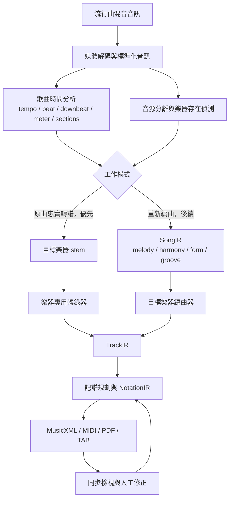

# AI Music to Sheet

把一首流行歌曲的混音音訊轉成可閱讀、可編輯、可播放的樂譜。

本專案規劃兩條彼此分離、共用底層能力的工作流水線：

1. **原曲忠實轉譜（優先）**：只轉錄原曲中實際存在的目標樂器聲部，輸出鼓譜、鋼琴譜或吉他譜／TAB。
2. **重新編曲（後續）**：理解旋律、和聲、曲式與節奏後，重新配置成指定樂器可演奏的版本。

所有產出必須明確標示 `transcription` 或 `arrangement`，不得把推測或重新編寫的音符冒充為原曲轉錄結果。

## 最終目標

使用者輸入一首流行曲音訊，選擇目標樂器與工作模式，系統輸出：

- 標準樂譜：MusicXML 與可閱讀的 PDF。
- 可播放／可交換資料：MIDI。
- 樂器專用記譜：鼓組記譜；吉他六線譜、調弦、capo 與奏法；鋼琴左右手、聲部與踏板資訊。
- 可追溯資訊：來源音訊雜湊、模型與參數版本、各階段信心值、人工修正紀錄及評估報告。

## 兩條工作流水線

### 共用核心

兩條流水線只共用下列基礎能力，不共用會混淆語意的決策：

- 媒體解碼、音訊標準化與來源雜湊。
- tempo、beat、downbeat、拍號、調性與段落分析。
- 音源分離、目標樂器存在偵測與信心值。
- 工作產物版本、來源追蹤、快取、重試及評估報告。
- TrackIR 到 NotationIR 的記譜與 MusicXML／MIDI／PDF 匯出。

鼓、鋼琴與吉他的 TrackIR 必須有各自的語意，不能強迫所有樂器只使用通用 `NoteEvent`：鼓需要鼓件與擊法；鋼琴需要聲部、手別及踏板；吉他需要弦、格、調弦、capo 與奏法。

## 開發策略與交付順序

採用「**共用核心 + 單一樂器垂直切片**」：每次讓一種樂器從真實混音輸入一路走到可驗證輸出，再擴充下一種樂器。避免三套重複基礎設施，也避免一開始打造尚未被實際案例驗證的萬用平台。

| 優先級 | 里程碑 | 主要交付 |
| --- | --- | --- |
| P0 | 契約與評估基線 | Artifact schema、資料來源追蹤、golden fixtures、版本化 benchmark |
| P1 | 真實歌曲共用前端 | 音訊標準化、歌曲時間分析、stem separation、樂器存在偵測 |
| P2 | 鼓譜垂直切片 | 混音音訊到可驗證鼓譜、MIDI、MusicXML、PDF |
| P3 | 同步檢視與修正 | 音訊／波形／小節／音符同步，增刪移動、分類、undo／redo |
| P4 | 鋼琴譜垂直切片 | 多音轉錄、延音、聲部與左右手、鋼琴記譜 |
| P5 | 吉他譜垂直切片 | 調弦、capo、弦格配置、和弦與奏法、標準譜與 TAB |
| P6 | 產品化 | 非同步工作、進度、快取、重試、取消、資源限制、多格式交付 |
| P7 | 重新編曲流水線 | SongIR、可演奏性限制、目標樂器編曲與獨立評估 |

選擇鼓作為第一個樂器，是因為它能先驗證混音處理、時間網格、樂器分離、事件信心值與記譜匯出的完整閉環，同時避開鋼琴及吉他的複雜音高歧義。

## 流程測試總則

任何階段在合併或宣告完成前，都必須同時具備：

1. **單元測試**：純函式、邊界條件、錯誤處理。
2. **契約測試**：輸入／輸出 schema、版本相容性、必要欄位及單位。
3. **階段整合測試**：真實上游 artifact 能被處理，下游能無特殊轉接讀取。
4. **端到端流程測試**：由原始媒體執行到可交付檔案，不得以手工檔案取代中間步驟。
5. **回歸測試**：固定 golden fixtures 與前一版比較，阻止無意義退步。
6. **基準測試**：在版本化、不可任意更換的資料集上計算品質、時間及資源指標。

每個流程測試都必須保存一份機器可讀的 `ProcessTestReport`，至少包含：

- `test_case_id`、輸入檔雜湊與資料集版本。
- 階段名稱、程式／模型／參數／artifact schema 版本。
- 開始與結束時間、硬體或執行環境、產物路徑。
- 品質指標、門檻、通過／失敗狀態及失敗原因。
- 人工修正是否介入；自動 benchmark 不得混入人工修正結果。

共同驗收規則：

- 至少包含正常案例、邊界案例及一個預期失敗案例。
- 相同版本、參數和輸入必須產生語意相同的結果；非決定性模型須固定 seed 或定義容許差異。
- 每個 artifact 必須通過 schema 驗證、來源追蹤檢查與下游 parse-back。
- 不得靜默降級；低信心、目標樂器不存在或輸入損壞時，必須回傳明確狀態。
- 品質門檻存放在版本化的 benchmark manifest；調降門檻必須附原因與評估報告。
- 新版本的核心品質指標不得比已發布基線絕對下降超過 2 個百分點，除非經明確核准。

## 各階段必備流程測試

### P0 — Artifact 契約與評估資料

**應具備功能**

- 定義 `SourceMedia`、`CanonicalAudio`、`SongAnalysis`、`StemSet`、各樂器 `TrackIR`、`NotationIR`、`EvaluationReport`。
- 每個 artifact 都包含 schema version、來源 artifact ID、內容雜湊、產生器版本、參數和信心資訊。
- 建立合成片段、隔離樂器、多軌混音及合法授權流行曲片段的版本化評估集。

**流程測試內容**

- 每種 artifact 執行 serialize → validate → deserialize → semantic equality round-trip。
- 缺少必要欄位、非法單位、未知重大版本、錯誤來源 ID 必須被拒絕。
- 由最終 MusicXML 反查到 TrackIR、stem、標準化音訊與原始媒體，來源鏈不得中斷。
- golden fixture 需記錄授權、checksum、切段位置、樂器標籤與 ground truth 版本。
- 評估器以已知完美答案測得滿分，以刻意偏移／漏音／錯音答案測得預期扣分。

**通過條件**：契約案例 100% 通過；來源鏈 100% 完整；評估器誤差在 fixture 定義的數值容差內。

### P1.1 — 媒體解碼與音訊標準化

**應具備功能**

- 接受 WAV、FLAC、MP3、M4A 及含音軌的常見影片容器。
- 產出固定 sample rate、channel layout、sample format 與 loudness policy 的 `CanonicalAudio`。

**流程測試內容**

- 同一段音訊使用各支援格式與不同 sample rate／聲道數輸入，檢查時長、對齊及內容雜湊策略。
- 測試立體聲、單聲道、極短音訊、前後靜音、clipping 與超長檔案。
- 測試不存在的檔案、無音軌影片、截斷或損壞媒體、未支援 codec。
- 驗證解碼錯誤不會留下被誤認為成功的半成品，重跑不會污染既有 artifact。

**通過條件**：標準化格式 100% 符合契約；時長誤差不超過一個輸出 frame；損壞輸入 100% 回傳結構化失敗。

### P1.2 — 歌曲時間與結構分析

**應具備功能**

- 偵測 tempo、beat、downbeat、拍號、速度變化、弱起與段落邊界。
- 所有事件以音訊時間為真值，並提供可逆的小節／拍點映射。

**流程測試內容**

- 固定速度 3/4、4/4、6/8；半拍／雙倍速度易混淆案例；弱起與休止開頭。
- accelerando、ritardando、現場演奏漂移、段落速度改變與拍號改變。
- click-track 合成資料用 sample-accurate ground truth；真實歌曲使用人工標註 beat／downbeat。
- 將偵測時間網格量化後再映射回秒數，檢查累積漂移與小節邊界。

**首版驗收門檻**：beat F1 ≥ 0.85、downbeat F1 ≥ 0.75、主 tempo 在 ±4% 內、拍號正確率 ≥ 90%；五分鐘歌曲末端的時間映射漂移 ≤ 50 ms。

### P1.3 — 音源分離與樂器存在偵測

**應具備功能**

- 從完整混音分離 drums、bass、vocals、piano、guitar 與 other；模型不支援細分類時，artifact 必須揭露實際 taxonomy。
- 在轉錄前判斷目標樂器存在、缺席或不確定，不可在缺席時憑空產生樂譜。

**流程測試內容**

- 以有隔離軌真值的多軌混音測試單一樂器、同時演奏、低音量目標、效果器及高密度副歌。
- 對目標樂器存在／缺席／只在部分段落出現建立平衡資料集。
- 檢查 stems 相加後可重建原混音，並量測目標 stem 的 SI-SDR improvement、bleed 與時間對齊。
- 測試模型無法提供指定 taxonomy、GPU 不足、模型檔損壞與中途失敗。

**首版驗收門檻**：樂器存在偵測 precision、recall 皆 ≥ 0.90；主要目標 stem 的 median SI-SDR improvement ≥ 6 dB；stem 與原音訊對齊誤差 ≤ 20 ms；低信心案例必須進入人工確認而非假成功。

### 共用 — 模式路由、編排與來源追蹤

**流程測試內容**

- 同一輸入分別選擇 `transcription` 與 `arrangement`，確認工作圖、artifact 型別與輸出標示不同。
- `transcription` 的每個音符／鼓擊必須能追溯到目標 stem 的時間區段和信心值。
- `arrangement` 新增或改寫的素材必須標記為編曲決策，不得偽造 stem 證據。
- 上游失敗、取消、逾時及低信心狀態必須阻止錯誤的下游工作啟動。

**通過條件**：跨模式污染測試 0 件；無來源的忠實轉譜事件 0 件；依賴狀態轉移 100% 符合工作圖。

### P2 — 鼓譜忠實轉錄

**應具備功能**

- 偵測 kick、snare、closed／open hi-hat、tom、ride、crash 及可擴充的鼓件 taxonomy。
- 支援同時擊打、ghost note、accent、flam、fill 與 swing／shuffle 時值。
- 產生鼓組 MIDI、percussion MusicXML 與可讀 PDF。

**流程測試內容**

- 先用隔離鼓軌測事件偵測，再用相同演奏的完整混音測 separation + transcription 整合。
- 每類鼓件需含單擊、連擊、同時擊打、弱音與密集 fill fixture。
- onset 以 50 ms 容差計算 per-class precision／recall／F1；另計 macro F1，避免只靠 hi-hat 數量取巧。
- MusicXML parse-back 後比較鼓件、onset、duration、voice、accent 與小節總時值。
- 負向案例包含無鼓歌曲、拍手被誤判為 snare、bass attack 被誤判為 kick。

**首版驗收門檻**：常見鼓件 micro F1 ≥ 0.85、全部受測鼓件 macro F1 ≥ 0.75；無鼓歌曲不得產生正式鼓譜；MusicXML parse-back 的事件與小節結構 100% 合法。

### P3 — 音訊同步檢視與人工修正

**應具備功能**

- 同步顯示音訊、波形、時間軸、小節與樂譜，定位低信心事件。
- 支援新增、刪除、移動、改音高／鼓件、改時值、量化、undo／redo、儲存及重開。
- 原始自動結果不可被覆寫；修正結果形成有操作歷史的新版本。

**流程測試內容**

- 從音訊 seek 到樂譜、從音符跳回音訊，檢查雙向同步。
- 對每種編輯操作執行 edit → undo → redo → save → reload，確認語意與歷史一致。
- 兩個修正版本同時存在時，不得改寫原始 artifact；匯出必須標示採用的版本。
- 低信心排序、空結果、上千事件、瀏覽器重整或程序重啟後復原。
- 端到端比較修正前後評估指標，確認編輯確實流入最終 MusicXML／PDF。

**通過條件**：音訊與游標同步誤差 ≤ 40 ms；編輯 round-trip 與 undo／redo 正確率 100%；原始 artifact 不可變性 100%；不得遺失已確認的使用者操作。

### P4 — 鋼琴譜忠實轉錄

**應具備功能**

- 多音音高、onset／offset、重複音、力度與 sustain pedal 轉錄。
- 聲部區分、左右手配置、跨手與可讀的鋼琴大譜表。

**流程測試內容**

- 單音、和弦、琶音、快速重複音、延音踏板、跨手、密集伴奏與旋律被人聲遮蔽案例。
- 依序測合成 MIDI render、隔離鋼琴、含隔離真值的混音及真實歌曲片段。
- 計算 note onset F1、note-with-offset F1、velocity correlation 及 pedal event F1。
- 檢查左右手音域不是唯一規則：fixture 必須涵蓋 voice continuity、交叉與跨手。
- MusicXML parse-back 檢查音高、時值、tie、voice、staff、pedal 與每小節完整性。

**首版驗收門檻**：50 ms onset 容差下 note onset F1 ≥ 0.80；note-with-offset F1 ≥ 0.70；接受的譜面不得有非法小節或無法演奏的未標示音符；MusicXML 可由至少兩個獨立 reader 開啟。

### P5 — 吉他譜／TAB 忠實轉錄

**應具備功能**

- 單音、和弦、節奏、調弦、capo、弦／格配置與聲部轉錄。
- 表示 bend、slide、hammer-on、pull-off、palm mute、harmonic 等可辨識奏法；無法確定時保留低信心而非臆測。
- 同時輸出標準譜與 TAB，兩者音高及節奏等價。

**流程測試內容**

- 標準與替代調弦、capo、開放和弦、封閉和弦、power chord、單音 solo、失真與 clean tone。
- 同音異弦、同和弦多種把位、快速換把及超出演奏範圍的負向案例。
- 以 DI／isolated guitar、re-amped 訊號、多軌混音與真實歌曲逐層測試。
- 計算 note／chord onset F1；弦格配置用 ground-truth accuracy 與 position-change cost 評估。
- TAB parse-back 後，以 `tuning + capo + string + fret` 重算音高，逐事件比對標準譜。

**首版驗收門檻**：note onset F1 ≥ 0.78、常見和弦辨識 F1 ≥ 0.75；所有正式輸出的弦格位置 100% 可演奏；TAB 與標準譜音高／節奏一致率 100%；未知調弦不得假設成標準調弦後靜默輸出。

### 共用 — 記譜與匯出

**應具備功能**

- 將樂器 TrackIR 轉為拍號正確、節奏可讀、跨小節 tie 合法的 NotationIR。
- 匯出 MusicXML、MIDI 與 PDF；鼓與吉他保留樂器專用語意。

**流程測試內容**

- 含附點、三連音、切分、跨小節延音、休止、弱起、拍號／速度變化的 fixture。
- NotationIR → MusicXML → parse-back，比較音符／鼓件、時值、voice、staff、tie、tempo 與 meter。
- MIDI parse-back 比較絕對時間、音高／鼓號、velocity 與 tempo map。
- PDF smoke test 檢查頁數、空白頁、截斷、重疊、缺字及可讀尺寸；代表性 golden score 需做視覺回歸。
- 對非法小節總時值、不可表示的 subdivision、空譜及超長譜測結構化錯誤。

**通過條件**：MusicXML／MIDI 可由至少兩個獨立 reader 解析；語意 round-trip 100% 落在契約容差內；PDF 無截斷、重疊或空白交付頁。

### P6 — 工作執行與產品化

**應具備功能**

- 非同步 job、進度、取消、重試、逾時、資源限制、內容定址快取及多格式下載。
- 階段失敗可從最後一個有效 artifact 重跑，不重算已驗證且版本相同的上游。

**流程測試內容**

- 同一輸入與參數重送需冪等；不同模型／參數／schema version 不得誤用快取。
- 在每個階段注入 crash、逾時、磁碟不足、GPU OOM 與損壞快取，驗證重試及清理。
- 測試排隊、執行中取消、完成後取消、程序重啟與多工作併發。
- 進度只能前進且對應真實階段；失敗不得顯示 100% 成功。
- 下載檔需驗證 checksum、content type、權限、路徑穿越與過期策略。

**通過條件**：冪等案例 100% 指向同一有效 artifact；錯誤快取命中 0 件；取消後不再消耗重大運算資源；所有注入失敗均有可診斷狀態且不產生假成功輸出。

### P7 — 目標樂器重新編曲

此階段在忠實轉譜穩定後開始，且必須維持獨立入口、artifact 與評估報告。

**應具備功能**

- 建立含 melody、harmony、key、form、groove 與重要音樂線索的 `SongIR`。
- 依目標樂器音域、同時發音數、肢體限制、難度與風格產生可演奏編曲。
- 保留歌曲可辨識性，同時明確記錄省略、移調、重新配聲與節奏簡化。

**流程測試內容**

- SongIR 使用有旋律、和弦、段落與節奏 ground truth 的歌曲測結構正確性。
- 各樂器以極端音域、過多同時音、快速跳位等 fixture 驗證限制求解與失敗回報。
- 編曲前後比較主旋律覆蓋率、和聲相容率、段落長度、重拍節奏特徵與移調一致性。
- 相同 SongIR、目標樂器、難度與 seed 應產生可重現結果。
- 由演奏者進行盲評：可演奏性、歌曲辨識度、記譜可讀性；不得拿主觀評分取代自動契約測試。
- 交叉模式測試必須證明編曲產物不會被忠實轉譜 API、檔名或 UI 標示為原曲聲部。

**首版驗收門檻**：所有硬性演奏限制零違反；主旋律重點覆蓋率 ≥ 90%；和聲相容率 ≥ 90%；盲評的可演奏性與辨識度中位數皆至少 4/5；跨模式誤標 0 件。

## Release Gates

| Gate | 可以宣告完成的條件 |
| --- | --- |
| M0 契約基線 | P0 契約、fixture、評估器與來源追蹤全部通過 |
| M1 共用前端 | 真實混音可穩定產出時間分析、stems 與樂器存在結果 |
| M2 鼓譜 MVP | 完整歌曲可由輸入走到可解析、可閱讀、可人工修正的鼓譜 |
| M3 修正閉環 | 修正可持久化、可追蹤並可靠流入所有匯出格式 |
| M4 鋼琴譜 MVP | 多音鋼琴流程達到 P4 benchmark 與記譜門檻 |
| M5 吉他譜 MVP | 吉他流程達到 P5 benchmark，標準譜與 TAB 等價 |
| M6 可交付產品 | 工作生命週期、快取、恢復、資源與下載測試全部通過 |
| M7 編曲 MVP | 編曲流水線獨立通過自動測試、演奏限制與盲評門檻 |

任何 Gate 都必須以完整的流程測試報告、可重現命令、benchmark manifest 與實際輸出 artifact 作為證據；「示範看起來可用」不等於完成。

## 現階段不納入範圍

- 未取得授權來源的自動下載或散布。
- 即時／直播轉譜。
- 一次生成完整管弦樂總譜。
- 在忠實轉譜尚未達標前，以生成式模型補齊不存在或聽不清楚的原曲聲部。
- 只靠單一主觀 demo、沒有 ground truth 與回歸測試的功能宣告。
