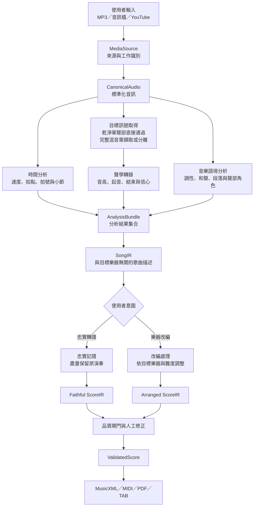
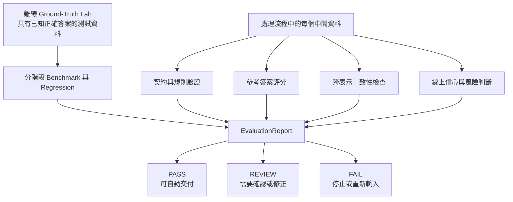

# 原曲轉樂譜與樂器改編

[Role-scoped reading and deployed skill bindings](docs/agent-reading.md) govern planning/history reads and repository-branch handling; existing product and role authorities remain in force.

> [!IMPORTANT]
> 本文件記錄專案的初步討論結果，不是不可變更的最終規格。專案目標、流程切割與里程碑都可以隨研究結果持續討論及修改。本文刻意不指定技術棧，也不描述更詳細的實作方法。

## 專案目標

終極目標是讓使用者提供 MP3 檔案或 YouTube 連結，由系統理解原曲內容，並產生使用者指定樂器可演奏的樂譜。使用者應能預覽、聆聽、修正低信心區段，並下載所需的樂譜格式。

專案包含兩種相關但不同的能力：

- **忠實轉譜：** 盡量保存原曲中的音符、節奏與聲部。
- **樂器改編：** 保留歌曲的可辨識內容，同時依目標樂器、音域與難度重新安排。

兩者共用歌曲理解流程，在 `SongIR` 後依使用者意圖分家，最後重新匯合至共同的樂譜驗證與輸出流程。樂器改編是終極方向；忠實轉譜則是可獨立完成、評估及持續擴充的能力。

## 設計原則

- 將整體問題拆成可獨立開發及驗收的階段，不建立無法定位錯誤的黑盒。
- 每個階段都產生可保存、可重播及可驗證的中間資料。
- 中間資料保留來源、版本、不確定性與信心資訊。
- 機器驗證橫跨整條流程；人工判斷是補充，不是唯一驗證方式。
- 忠實轉譜、樂器改編、產品平台與驗證工作軌可以分別前進，再透過穩定的資料介面整合。
- 先用受限、可量測的輸入建立可靠閉環，再逐步接近完整原曲與多種樂器。

## 整體架構圖

## 流程說明

| 階段 | 目的 | 主要產出 |
|---|---|---|
| 媒體取得 | 接收檔案或連結，確認來源與工作身分 | `MediaSource` |
| 音訊標準化 | 將不同來源轉成後續流程共同理解的音訊 | `CanonicalAudio` |
| 目標訊號取得 | 取得準備辨識的單聲部、主旋律或指定聲部 | `TargetSignal` |
| 時間分析 | 建立真實時間與音樂拍點、小節之間的關係 | `TimeMap` |
| 聲學轉錄 | 將目標聲音轉成音高及音符事件 | `PitchContour`、`NoteEvents` |
| 音樂語境分析 | 描述調性、和聲、段落及聲部角色 | 分析結果 |
| 分析整合 | 合併各分析結果及其不確定性 | `AnalysisBundle` |
| 歌曲描述 | 表示歌曲包含什麼，不套用目標樂器限制 | `SongIR` |
| 忠實轉譜／樂器改編 | 依使用者意圖產生實際演奏內容 | `ScoreIR` |
| 品質與修正 | 檢查結構、風險及可演奏性，保存人工修正 | `ValidatedScore` |
| 匯出交付 | 產生可編輯、可播放或可列印的樂譜 | 交付檔案 |

時間、音高與音樂語境分析不一定是完全線性的流程；它們可能互相提供線索，但仍應透過明確的中間資料交換結果。

## 核心中間資料

| 資料 | 代表意義 |
|---|---|
| `MediaSource` | 使用者提供的來源及工作識別 |
| `CanonicalAudio` | 全系統共同使用的標準音訊 |
| `TargetSignal` | 準備進行聲學轉錄的目標聲音 |
| `AnalysisBundle` | 時間、音高、音符與音樂語境的分析集合 |
| `SongIR` | 與目標樂器無關的歌曲描述 |
| `InstrumentProfile` | 目標樂器與指定難度的演奏限制 |
| `ScoreIR` | 實際要演奏及如何記譜的內容 |
| `CorrectionPatch` | 可追蹤、可重播的人工修正 |
| `EvaluationReport` | 各階段的機器驗證結果與風險狀態 |

這些名稱目前是架構討論中的工作語言，不代表格式已經定案；它們會依後續研究與實際需要調整。

## 機器驗證與評估

驗證不是流程最後才執行的一次檢查，而是一條橫跨所有階段的獨立工作軌。

離線測試資料負責衡量已知案例的準確度；處理沒有參考譜的新歌曲時，系統只能根據規則、一致性與信心判斷風險，不能嚴格證明每個音都正確。樂器改編也沒有唯一正解，因此機器可驗證合法性與可演奏性，但音樂性仍可能需要人類判斷。

## 工作軌

### 轉錄軌：Audio → SongIR

從受限的乾淨單聲部音訊開始，逐步加入拍點與節奏、完整混音中的目標聲部，以及更完整的和聲與段落理解。

### 改編軌：SongIR → ScoreIR

先以正確、可控制的歌曲資料驗證單一目標樂器的改編，再逐步加入難度、可演奏性，以及對不完整轉錄結果的容錯。

### 產品平台軌

負責輸入、工作狀態、處理進度、預覽、修正、下載，以及後期的 YouTube、資料保存、隱私與版權議題。

### 驗證軌

負責測試資料、客觀評分、版本回歸、單次工作風險及長期品質監測。

## 專案規劃

| 里程碑 | 可展示的閉環 | 目的 |
|---|---|---|
| `M0` 架構地基 | 中間資料契約、ground truth 與驗證報告 | 在研究模型前固定比較方式 |
| `M1` 聲學實驗 | 乾淨單聲部音訊 → `NoteEvents` | 可量測音高與起止辨識能力 |
| `M2` 單聲部樂譜 | 音訊 → 節拍量化 → `ScoreIR` → 樂譜 | 分離聲學錯誤與記譜錯誤 |
| `M3` 使用者閉環 | 上傳 → 進度 → 預覽／修正 → 下載 | 驗證完整產品互動 |
| `M4` 原曲主旋律 | 完整混音 → 主旋律 → 忠實單聲部譜 | 接近「使用者提供原曲」 |
| `M5` 第一個改編 | `SongIR` → 指定單聲部樂器譜 | 獨立驗證改編能力 |
| `M6` 終極閉環 | MP3／YouTube → 歌曲理解 → 指定樂器改編 | 完成終極產品目標 |

`M0` 是目前建議的下一階段。它的目的不是開始選擇模型，而是先定義可比較的測試案例、中間資料、正確答案及驗證報告，讓後續每次研究都有共同的判斷基準。

## 尚待討論

- 原曲內容應保留主旋律、指定聲部、旋律加和弦，或整首縮編？
- 各里程碑的成功標準與可接受誤差為何？
- 允許多少人工修正？
- 第一批支援哪些音樂類型、音域、錄音條件及歌曲長度？
- 第一批交付哪些樂譜格式？
- 可接受的處理時間與成本為何？
- YouTube、著作權、隱私與音訊保存政策如何處理？

## 文件範圍

本 README 只描述專案目標、概念架構、流程切割與階段規劃。技術棧、模型選擇、程式結構、資料欄位及更詳細的實作方式，會在對應階段確認需求後另外研究及記錄。

較完整的討論紀錄請參考 [`docs/superpowers/specs/2026-08-20-audio-to-instrument-score-design.md`](docs/superpowers/specs/2026-08-20-audio-to-instrument-score-design.md)。
