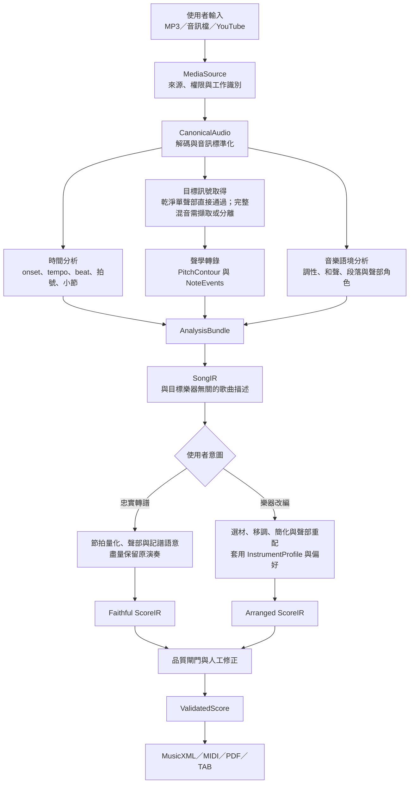
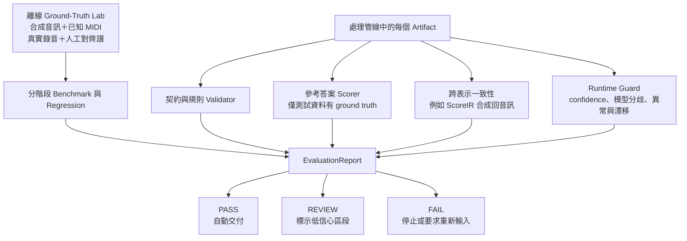

# 原曲轉樂譜與樂器改編：專案雛型

**狀態：** 已確認作為後續討論的架構地基；技術選型與準確率門檻尚待逐階段研究。
**日期：** 2026-08-20
**終極目標：** 使用者提供 MP3 或 YouTube 連結，系統理解原曲內容，並輸出指定樂器可演奏、可預覽、可修正及可下載的樂譜。

## 1. 核心認知

這不是一次性的「音訊丟給模型、直接得到 PDF」，而是一條可觀測的資料轉換鏈。每個階段都必須：

1. 接受明確定義的輸入；
2. 產生可保存、可重播的中間資料；
3. 附帶來源、版本與信心分數；
4. 產生機器可讀的驗證報告；
5. 能在不更動其他階段介面的情況下替換實作。

忠實轉譜與樂器改編不是互相衝突的版本。兩者共用前段的歌曲理解，在 `SongIR` 後依使用者意圖分家，最後再收斂到共同的 `ScoreIR`、品質檢查及輸出流程。

## 2. 使用者旅程

早期里程碑只實作這段旅程的子集合；終極介面不應迫使所有後端能力一次完成。

## 3. 完整處理流程

### 3.1 階段與責任

| 階段 | 輸入 | 輸出 | 責任與明確排除事項 |
|---|---|---|---|
| 媒體取得 | 檔案或 URL | `MediaSource` | 驗證來源與格式；不做音樂判斷。 |
| 音訊標準化 | `MediaSource` | `CanonicalAudio` | 解碼、聲道與取樣格式統一；不辨識音符。 |
| 目標訊號取得 | `CanonicalAudio` | `TargetSignal` | 乾淨單聲部可直接通過；完整混音才需要主旋律擷取或 stem 分離。 |
| 時間分析 | `CanonicalAudio` | `TimeMap` | 建立秒數、拍點、速度與小節的映射。 |
| 聲學轉錄 | `TargetSignal` | `PitchContour`、`NoteEvents` | 判斷音高、起音、結束與信心；不決定五線譜排版。 |
| 音樂語境 | 音訊與分析結果 | 調性、和聲、段落、角色 | 為完整原曲理解及改編提供上下文；早期單旋律可延後。 |
| 歌曲整合 | 前述分析 | `SongIR` | 合併歌曲事實與不確定性；不套用目標樂器限制。 |
| 忠實轉譜 | `SongIR` | `Faithful ScoreIR` | 量化並保留原演奏內容；輸出是估計轉譜，不宣稱為官方原譜。 |
| 樂器改編 | `SongIR`、樂器規格、偏好 | `Arranged ScoreIR` | 轉換而非忠實複製；需符合音域、聲部及難度。 |
| 品質與修正 | `ScoreIR` | `ValidatedScore` | 阻止非法或高風險結果，保存人工修正差異。 |
| 匯出 | `ValidatedScore` | 交付檔案 | 產生、重新解析並驗證 MusicXML、MIDI、PDF 或 TAB。 |

分析中心內的工作不一定完全線性。例如 tempo、onset 與音符切割可能互相提供線索；模組仍應透過版本化 artifact 交換結果，而不是直接存取彼此內部狀態。

## 4. 核心中間資料

| Artifact | 描述 | 主要驗收內容 |
|---|---|---|
| `MediaSource` | 使用者來源、權限、檔案資訊與工作識別 | 可讀性、格式、大小、來源追蹤 |
| `CanonicalAudio` | 全系統統一使用的波形 | 時長、取樣率、聲道、clipping、靜音與截斷 |
| `TargetSignal` | 準備進行音高分析的目標聲音 | 是否符合單聲部／目標聲部假設 |
| `AnalysisBundle` | `TimeMap`、音高、音符與音樂語境結果 | 各分析項目的版本、信心與來源 |
| `SongIR` | 描述歌曲「包含什麼」，與目標樂器無關 | 音符順序、聲部角色、時間骨架、語意一致性 |
| `InstrumentProfile` | 目標樂器及指定難度的演奏限制 | 音域、同時發音數、技巧與難度規則 |
| `ScoreIR` | 描述實際要演奏及如何記譜的內容 | 小節、時值、聲部、音域、可演奏性 |
| `CorrectionPatch` | 人工修正與原因 | 可追蹤、可重播且不覆寫原始推論 |
| `EvaluationReport` | 每階段的指標、門檻與失敗區段 | 模型／程式版本、分項指標、`PASS`／`REVIEW`／`FAIL` |

`SongIR` 與 `ScoreIR` 是專案內部概念，不預設為既有標準格式。初期應保持最小化；只有下游的真實需求出現時才擴充欄位。MusicXML 與 MIDI 是 importer／exporter 的 adapter，不是核心模型本身。

## 5. 機器驗證與評估平面

驗證是橫跨所有階段的獨立工作軌，而不是流程末端的一次檢查。

### 5.1 四層驗證

1. **契約與規則驗證：** schema、型別、時間順序、單聲部、小節總值、樂器音域與格式 round-trip。回答「資料有效嗎？」
2. **參考答案評分：** 以標註 MIDI／MusicXML 計算音高、onset、offset、beat 與節奏誤差。回答「已知案例準嗎？」
3. **跨表示一致性：** 將 `ScoreIR` 合成回音訊，比較旋律輪廓、節奏與來源特徵。回答「結果一致嗎？」但不能取代 ground truth。
4. **線上風險判斷：** confidence 校準、模型分歧、異常偵測及資料漂移。回答「這次能自動交付嗎？」

### 5.2 必須接受的限制

對沒有參考譜的新歌曲，機器無法嚴格證明每個音都正確；否則驗證器本身就在解同一個轉錄問題。線上驗證只能累積可信證據並管理風險。樂器改編也沒有唯一正解：機器可以排除違反音域、聲部、節奏或可演奏性規則的結果，但「音樂性」與「是否是最佳改編」仍需使用者或專家評估。

### 5.3 發布與執行閘門

- **提交閘門：** schema、不變量、golden fixtures 與 exporter round-trip 測試。
- **模型發布閘門：** 固定 benchmark 不得退步；依音域、速度、音色及錄音條件分組觀察，避免總平均掩蓋問題。
- **單次工作閘門：** 依 `EvaluationReport` 決定 `PASS`、`REVIEW` 或 `FAIL`。
- **營運漂移閘門：** 監測輸入分布、confidence、失敗率與使用者修正量的長期變化。

## 6. 工作軌與相依關係

### 6.1 轉錄軌：Audio → SongIR

- `T0`：建立測試音訊、人工標註與分項評分方式。
- `T1`：乾淨、已分離且一次只出現一個音的錄音 → `NoteEvents`。
- `T2`：加入 `TimeMap` 與節拍量化 → 單聲部 `SongIR`。
- `T3`：完整混音 → 主旋律或指定 stem。
- `T4`：加入多聲部、和聲與段落理解。

### 6.2 改編軌：SongIR → ScoreIR

- `A0`：定義單一目標樂器的 `InstrumentProfile`。
- `A1`：使用人工正確的 `SongIR` 產生單聲部改編，避免等待音訊轉錄成熟。
- `A2`：加入移調、難度、節奏簡化與可演奏性規則。
- `A3`：接受帶 confidence、缺漏與錯誤的實際轉錄 `SongIR`。

### 6.3 產品平台軌

- `P0`：可重現的批次工作與 artifact 儲存。
- `P1`：上傳、佇列、階段進度、取消及錯誤狀態。
- `P2`：預覽、同步聆聽、低信心標記與人工修正。
- `P3`：YouTube 輸入、保存／刪除政策、版權與營運限制。

### 6.4 驗證軌

- `V0`：定義 `EvaluationCase`、`EvaluationReport` 與最低測試語料。
- `V1`：以已知音符合成音訊，驗證時間與音高的基本正確性。
- `V2`：加入真實錄音及人工對齊參考譜，衡量泛化能力。
- `V3`：加入困難案例、反例、版本 regression 與線上漂移監測。

## 7. 整合里程碑

| 里程碑 | 可展示的閉環 | 主要目的 |
|---|---|---|
| `M0` 架構地基 | Artifact 契約、ground-truth 測試集與驗證報告 | 在研究模型前先固定比較方式 |
| `M1` 聲學實驗 | 乾淨單聲部音訊 → `NoteEvents`／測試 MIDI | 可量測音高與起止辨識能力 |
| `M2` 單聲部樂譜 | 音訊 → 節拍量化 → `ScoreIR` → MusicXML／PDF | 分離聲學錯誤與記譜錯誤 |
| `M3` 使用者閉環 | 上傳 → 進度 → 預覽／修正 → 下載 | 驗證完整產品互動，輸入仍受限 |
| `M4` 原曲主旋律 | 完整混音 → 主旋律 → 忠實單聲部譜 | 第一次接近「使用者給原曲」 |
| `M5` 第一個改編 | 正確或高信心 `SongIR` → 指定單聲部樂器譜 | 獨立驗證改編能力 |
| `M6` 終極閉環 | MP3／YouTube → 歌曲理解 → 指定樂器改編 → 修正與輸出 | 完成終極產品目標 |

`M0` 是所有研究的前置條件。`T1` 與 `A1` 可在共享契約確定後分開進行；不能把改編完全推遲到轉錄成熟，否則會太晚才發現 `SongIR` 缺少改編所需資訊。

## 8. 尚待依序確認的產品決策

在研究每階段的實作方法前，需逐題確認：

1. 原曲需要保留主旋律、指定原樂器、旋律加和弦，還是整首縮編？
2. 成功標準是音高正確、節奏正確、可辨識、可演奏，還是可直接出版？
3. 允許多少人工修正：全自動、只確認低信心區段，或提供完整編輯器？
4. 第一批支援的音樂類型、音域、歌曲長度與錄音條件為何？
5. 第一個交付格式是 MIDI、MusicXML、PDF，還是其組合？
6. 可接受的處理時間與每首歌曲成本為何？
7. YouTube、使用者權利聲明、音訊保存、隱私及刪除政策為何？

## 9. 下一階段討論順序

下一步不是立即選模型，而是先完成 `M0` 的設計討論：

1. 定義第一個 `EvaluationCase` 的輸入範圍與 ground truth；
2. 定義 `NoteEvents` 的最小欄位及容許誤差；
3. 定義分項指標與 `PASS`／`REVIEW`／`FAIL` 門檻；
4. 再研究「乾淨單聲部音訊 → NoteEvents」可採用的實作方法；
5. 通過小型可行性驗證後，才寫第一個正式實作計畫。
